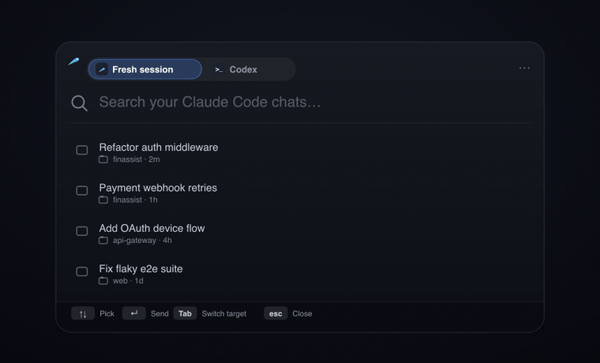

<p align="center">
  <picture>
    <source media="(prefers-color-scheme: dark)" srcset="docs/whoosh-logo-dark.png">
    
  </picture>
</p>

<p align="center"><b>Switch coding agents — or restart one fresh — without losing context.</b></p>

<p align="center">
  
</p>

---

## What it does

One hotkey — **⌘⇧Space** — moves a coding chat between **Claude Code** and **Codex**,
with your context already loaded. Pick a chat, press Return, and the destination opens
with the goal, your last request, your project's conventions, **and your uncommitted
diff** in the composer. You review, you send. Whoosh. 💨

Two moves, one hotkey:

- **Fresh session** — your chat has gotten long and the model is drifting? Whoosh it
  into a clean session of the *same* agent with the full context reloaded. No rot.
- **Switch tools** — press **Tab** and send it to the other agent instead.

## Install

```sh
brew install --cask srics96/tap/whoosh
/usr/bin/xattr -dr com.apple.quarantine "/Applications/Whoosh.app"   # one-time OK to run it
```

Or download [**Whoosh.dmg**](https://github.com/srics96/Whoosh/releases/latest/download/Whoosh.dmg),
drag it to Applications, then **right-click → Open** the first time.

Then press **⌘⇧Space**. Whoosh lives in your menu bar (the comet). ☄️

> **First launch:** Whoosh is open-source and free, so it isn't signed with a $99/yr
> Apple certificate — macOS flags *every* app like that until you OK it once. That's the
> `xattr` line (or right-click → Open). After that it just launches. The whole app is in
> this repo if you want to read what it does first.

> Needs an **Apple Silicon Mac** and **Claude Code and/or Codex** installed. Whoosh moves
> chats between them; it doesn't replace them.

## How to use it

| Key | Does |
| --- | --- |
| **⌘⇧Space** | open Whoosh |
| type / **↑ ↓** | filter and pick a chat |
| **Return** | send the chat you picked |
| **Tab** | switch target — fresh session ⇄ the other agent |

First time, click **Connect** once per agent. The destination opens pre-filled — you
review it and press Send. **Whoosh never sends for you.**

## What actually moves

Not just the transcript. Whoosh carries:

- a short **brief** — the goal and where you are,
- your **`CLAUDE.md` / `AGENTS.md`** conventions,
- your **uncommitted diff** and changed-file list,
- the full transcript.

The diff is what makes this un-copy-pasteable: the new session resumes on the real state
of your working tree, not a stale snapshot. It's all dropped as local files the new agent
reads — nothing bulky gets crammed into a URL, so big chats move fine.

## Good to know

- Reads **only the chat you pick** — read-only, all local, nothing auto-sent.
- Codex via its signed CLI (even the one inside the Codex app); Claude Code via
  Anthropic's official SDK.
- Git is read-only — branch, commit, changed files, and the uncommitted diff — with
  external diff/textconv off, so no repository script runs. If the repo declares content
  filters, diff content is skipped and only the file list is kept.
- Open-source prototype, **ad-hoc signed, not Apple-notarized** — that's why it needs one
  Gatekeeper approval (right-click → Open, or the `xattr` line above).

<details>
<summary><b>Build it yourself</b></summary>

macOS 13+ and the Xcode Command Line Tools (Swift 5.9+).

```sh
bash scripts/build-app-direct.sh   # → dist/Whoosh.app  (swiftc build; see note)
bash scripts/package-dmg.sh        # → dist/Whoosh.dmg  (self-contained, Apple Silicon)
open dist/Whoosh.app
```

For the **Claude Code source**, install its SDK once first:

```sh
( cd Resources/ClaudeAdapter && npm install )
```

Note: some Command Line Tools installs make `swift build` fail at the manifest step (a
`libPackageDescription` mismatch). `build-app-direct.sh` compiles the targets with
`swiftc` directly to dodge that.

</details>

<details>
<summary><b>How the handoff works + what's in the package</b></summary>

Whoosh reads your chat, writes a resume packet to
`~/Library/Application Support/Whoosh/Handoffs/`, then opens the destination with a short
bootstrap that points at it:

```text
Whoosh-<timestamp>-<random>/
  BRIEF.md                   # Goal, latest request, recent exchange — resume from here
  context/                   # Copied CLAUDE.md / AGENTS.md conventions
  workspace/changes.diff     # Your uncommitted staged + unstaged diff
  transcript/original.<ext>  # Full transcript (SHA-256 verified on write)
  manifest.json              # Byte/hash evidence, checkpoint, Git metadata
  CHECKPOINT.md  bootstrap.txt  README.txt
```

The Codex CLI is signature-verified before it runs. Opening a destination means it opened
pre-filled, not that the agent read it.

**Code:** `RelayCore` (models, archives, handoff writer), `RelayCore/Providers` (read-only
Codex adapter), `RelayApp` (SwiftUI/AppKit UI, hotkey, animation), `Resources/ClaudeAdapter`
(Claude session reader), `scripts` (build/package/icons).

**Protocols:** [Claude deep links](https://support.claude.com/en/articles/14729294-open-claude-desktop-with-a-link) · [Codex app-server](https://learn.chatgpt.com/docs/app-server)

</details>

---

Open-source. No credentials, exports, or real conversations live in this repo — fixtures
are synthetic.
